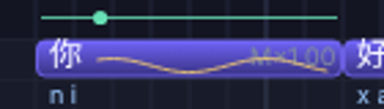
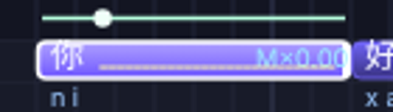
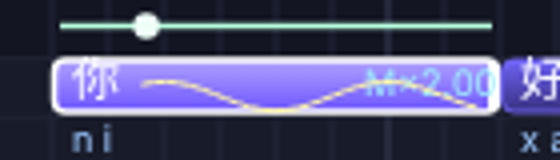
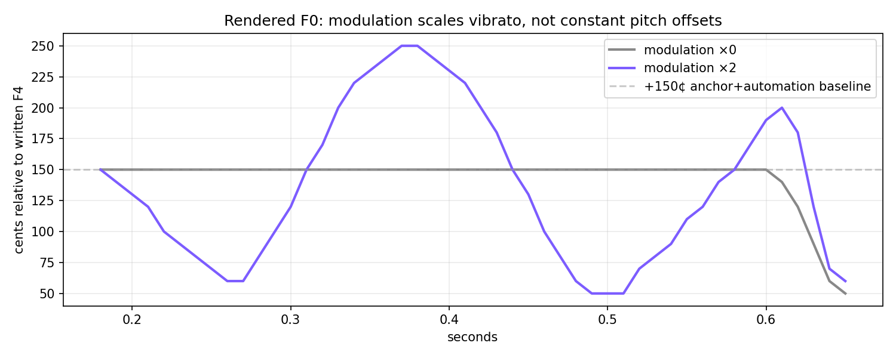
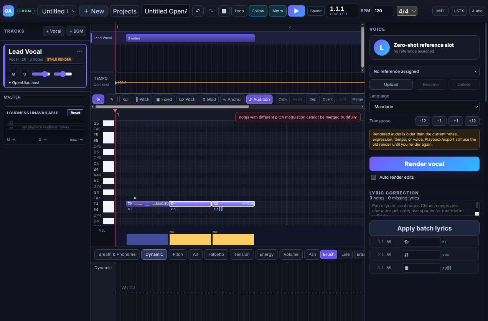
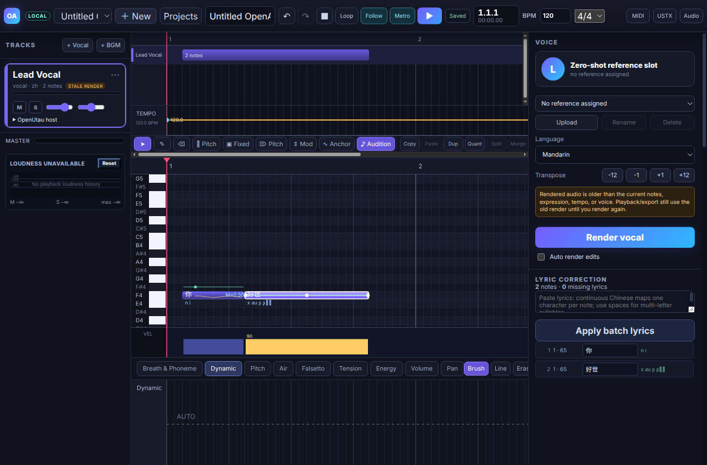

# Pitch modulation tool QA report

Branch/revision: current uncommitted pitch-modulation implementation. Frontend rebuilt/restarted and cache-busted; served bundle `index-D6HMwZTw.js`.

## Defects

No product defect found in this focused browser QA.

Setup disclosure: exact initial notes, vibrato, pitch anchor, and constant user-pitch automation were seeded through the project API for deterministic setup. All modulation drags, undo/redo, merge attempts, handle drags, select movement, and renders under test were driven visibly in Chrome.

## Exact setup

Main note `note_mod`:

- geometry: `start_ticks=120`, `duration_ticks=480`, `pitch=65`
- vibrato: `start_ratio=0.2`, `depth_cents=60`, `frequency_hz=4.0`, `phase=π/2`, zero attack/release
- per-note pitch anchor: `+100¢` at `offset_ms=100` (constant because it is the only anchor)
- initial `pitch_modulation=1`

Track user-pitch automation: constant `+50¢` from tick `0` to `1560`.

Merge regression notes: `note_merge1` at tick `600` and `note_merge2` at tick `1080`, contiguous, both initially modulation `1`.

## Results

### 1. Shortcut and badge/sine visibility

- Shortcut `5` activated `⇕ Mod`: passed (`shortcut5_active=true`).
- In modulation mode the badge was visible even at default `M×1.00`.
- Non-default badges displayed exact values such as `M×0.00` and `M×2.00`.
- Sine preview flattened completely at modulation `0` and amplified at modulation `2`.

| Default ×1 | Flattened ×0 | Amplified ×2 |
|---|---|---|
|  |  |  |

### 2. Vertical drag exact values, clamps, undo/redo, reload

All values below are backend-exact:

| Gesture | Result |
|---|---|
| down 60 px from ×1 | `0.5` exactly |
| undo | `1.0` |
| redo | `0.5` |
| down 300 px from ×0.5 | clamped to `0.0` |
| undo | `0.5` |
| redo | `0.0` |
| up 300 px from ×0 | clamped to `2.0` |
| undo | `0.0` |
| redo | `2.0` |
| down 180 px from ×2 | `0.5` exactly |
| reload | `0.5` exactly |

Thus directionality is correct: downward flattens, upward amplifies; range clamps exactly at `[0,2]`; transactional undo/redo and reload persistence pass.

### 3. Written pitch, anchors, automation, geometry invariance

After all modulation drags, these remained exactly unchanged:

- all note start/duration/pitch geometry
- main note written pitch `65`
- pitch anchor `[{offset_ms:100, cents:100}]`
- track user automation `[+50¢ @ 0, +50¢ @ 1560]`

`invariance_after_drags.unchanged=true`.

### 4. Target-pitch evidence: only vibrato contribution scales

Production target-expression analysis using the saved project snapshots (`target_pitch_modulation_analysis.json`):

| modulation | offset 50ms before vibrato | offset 187.5ms vibrato zero | offset 250ms vibrato peak | offset 312.5ms vibrato zero |
|---:|---:|---:|---:|---:|
| ×0 | 150¢ | 150¢ | 150¢ | 150¢ |
| ×0.5 | 150¢ | 150¢ | 180¢ | 150¢ |
| ×1 | 150¢ | 150¢ | 210¢ | 150¢ |
| ×2 | 150¢ | 150¢ | 270¢ | 150¢ |

This is exact proof that:

- constant `+150¢` anchor+automation offset remains unscaled;
- vibrato-zero crossings remain exactly `+150¢`;
- only the deterministic vibrato deviation scales: `0/+30/+60/+120¢` at the peak for `×0/×0.5/×1/×2`.

### 5. Fixture rendered-F0 evidence

Both fixture renders completed and wrote sibling `f0.json` files.

Central window `0.30–0.55s`, relative to written F4 (`rendered_f0_modulation_analysis.json`):

| render | peak-to-peak | mean | min/max |
|---|---:|---:|---:|
| modulation ×0 | `0.0¢` | `150.0¢` | `150 / 150¢` |
| modulation ×2 | `200.0¢` | `150.77¢` | `50 / 250¢` |

The ×0 render is exactly flat at the constant `+150¢` anchor+automation offset, while ×2 oscillates around approximately the same mean. This confirms the fixture render consumes pitch modulation and does not scale the constant written/anchor/user-pitch offset.



Copied render evidence:

- `mod0_vocal.wav`, `mod0_f0.json`
- `mod2_vocal.wav`, `mod2_f0.json`

### 6. Merge compatibility

Mismatched merge test:

- `note_merge1`: modulation `1.0`
- `note_merge2`: visibly dragged to modulation `0.5`
- selected exactly two notes (`2 selected`)
- merge rejected with exact actionable error:

```text
notes with different pitch modulation cannot be merged truthfully
```

- project remained uncorrupted with `note_count=3`.



Same-modulation regression:

- `note_merge2` visibly dragged back to `1.0`
- merge succeeded
- note count `3 → 2`
- merged note exact core properties:
  - `start_ticks=600`
  - `duration_ticks=960`
  - `pitch_modulation=1.0`
  - lyric `好世`



### 7. Vibrato handle/envelope regression

After setting envelope values as test setup (`attack=0.25`, `release=0.20`):

- purple attack handle dragged 32 px right: `attack_ratio 0.25 → 0.45` exactly
- release remained `0.20`
- depth handle dragged 20 px up: `depth_cents 60 → 90` exactly
- `pitch_modulation` remained `0.5`

### 8. Ordinary select regression

Select/move worked. Because the moved note is contiguous with the following merged note, overlap resolution predictably changed the moved state from `start=120,duration=480` to `start=240,duration=360`; one undo restored exactly `start=120,duration=480,pitch=65`.

## Cleanliness and harness note

- 1272px layout: no body overflow; no right-panel overflow.
- Backend log: no HTTP 500s or tracebacks observed.
- The 422 network/console entry was the intentional mismatched-merge rejection.
- The 409 rendered-F0 network entry was normal freshness gating while the render was stale.
- During harness development, shortcut `1` was initially misused as if it meant select; OpenACE uses `1` for freehand pitch brush and `V` for select. The resulting harness pollution was reset through the project API before the final recorded merge/regression run. Final reported results are from the corrected visible flow.

## Artifact index

- `pitch_modulation_stage1_results.json` — exact drag/undo/reload/invariance/render job results
- `pitch_modulation_stage2_results.json` — merge/regression results
- `target_pitch_modulation_analysis.json` — exact production target-pitch table
- `rendered_f0_modulation_analysis.json` — quantitative rendered-F0 comparison
- `rendered_f0_modulation_comparison.png` — chart
- `snapshot_mod_*.json` — exact project snapshots at ×0, ×0.5, ×1, ×2
- screenshots `00_…` through `07_…` and zoomed `*_crop.png`
