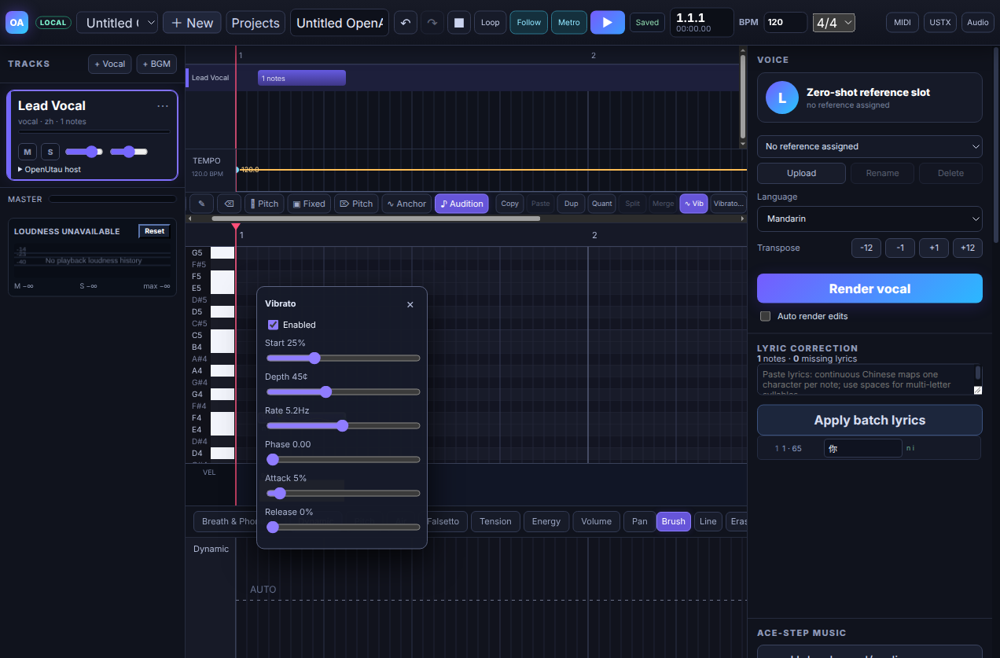

# Numeric vibrato slider undo-fix addendum

Retest scope: only the numeric-slider undo-history defect. Frontend rebuilt/restarted/cache-busted; served bundle `index-DgLxlMRC.js`.

## Result: fixed; no defect reproduced

Exact repro results (`numeric_undo_fix_results.json`):

1. Direct-created vibrato was exactly:

```json
{
  "start_ratio": 0.25,
  "depth_cents": 45.0,
  "frequency_hz": 5.2,
  "phase": 0.0,
  "attack_ratio": 0.0,
  "release_ratio": 0.0
}
```

2. Undo was enabled immediately after direct creation.
3. Numeric Attack slider received five `ArrowRight` steps and backend value became exactly `attack_ratio: 0.05`.
4. After waiting for autosave/server echo:
   - Undo enabled while slider still focused: **true**
   - Undo enabled after canvas refocus: **true**
5. One `Ctrl+Z` reverted the coalesced five-step numeric edit as one edit:
   - `attack_ratio: 0.05 → 0.0`
   - direct-created vibrato itself remained present
   - unrelated creation parameters remained `start_ratio 0.25`, `depth_cents 45`, `frequency_hz 5.2`, `phase 0`, `release_ratio 0`
   - it did **not** unexpectedly remove the vibrato creation
6. `Ctrl+Shift+Z` restored exactly the post-slider object with `attack_ratio: 0.05`.



## Exact attack/release persistence

After setting sliders numerically:

```json
{
  "attack_ratio": 0.25,
  "release_ratio": 0.2
}
```

Reloaded backend object matched the full pre-reload vibrato object exactly.

## Canvas handle regression

After reload, dragging the purple attack handle 32 px right produced exactly:

```json
{
  "attack_ratio": 0.45,
  "release_ratio": 0.2
}
```

`start_ratio`, `depth_cents`, `frequency_hz`, `phase`, note start/duration/pitch all remained unchanged.

## Cleanliness

- Browser console errors/warnings: none
- Failed browser network responses: none
