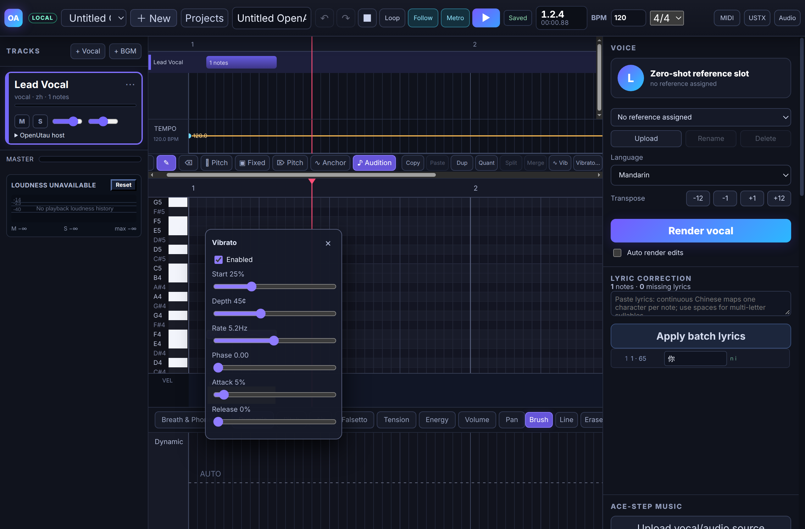
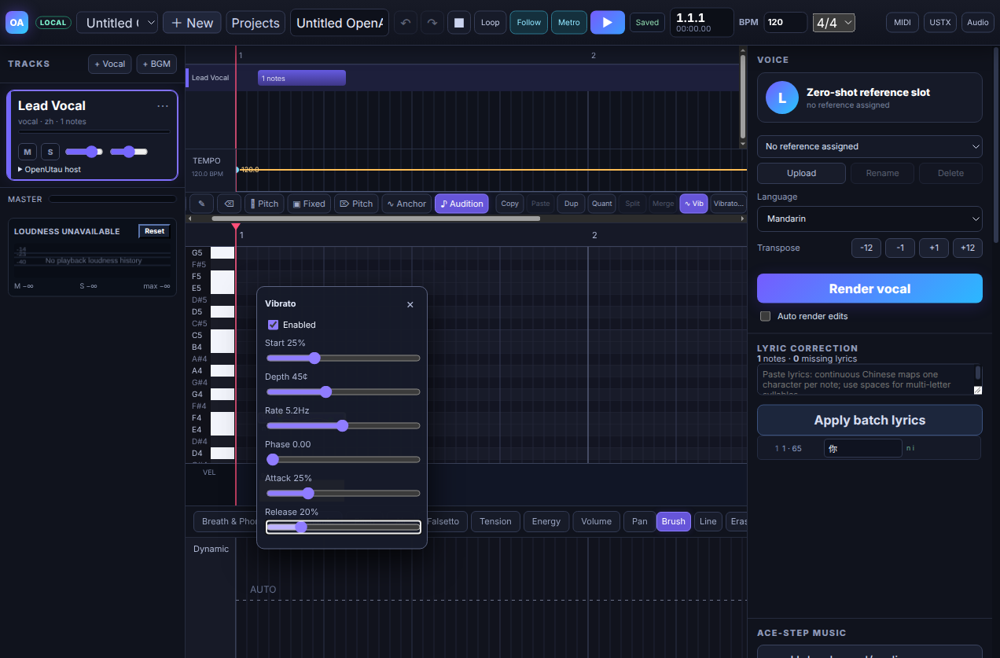
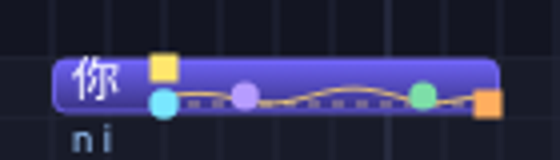
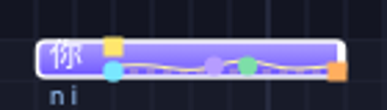
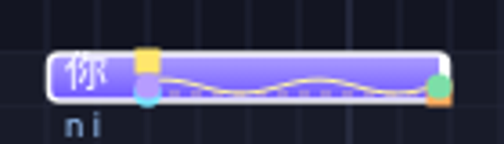
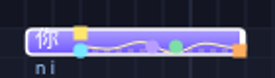
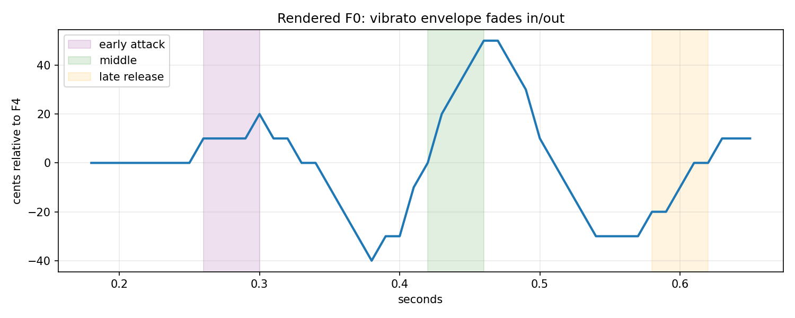
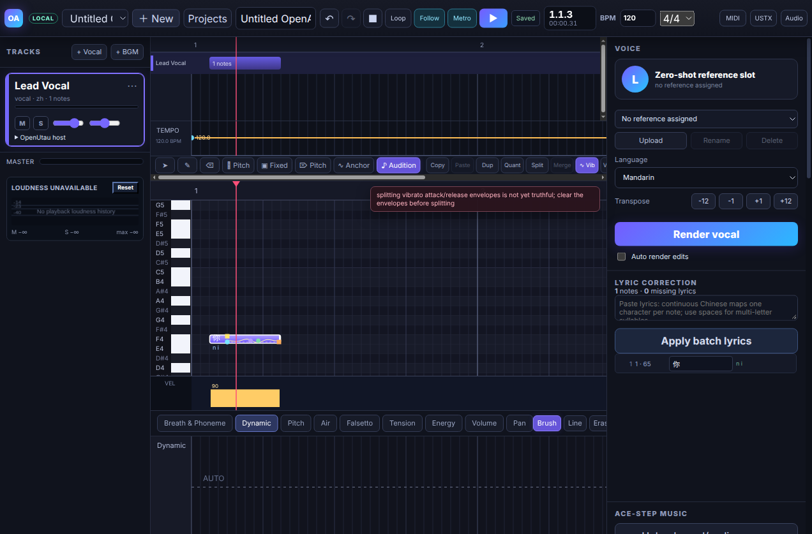
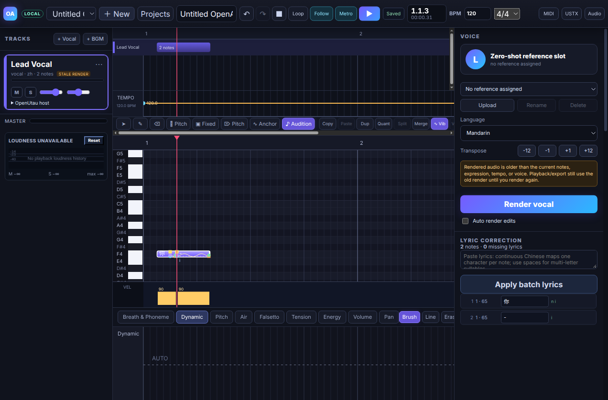

# Vibrato attack/release envelope QA report

Branch/revision: `devin/1795696369-dynamic-expression`, uncommitted vibrato-envelope implementation. Frontend rebuilt/restarted and cache-busted; backend bundle probe was `index-CMRiBL5p.js`.

## Defect found

### P1/P2 — numeric vibrato slider edits clear the entire undo history after autosave/server echo

Visible-browser repro:

1. Create a note and direct vibrato. Undo is enabled.
2. Open `Vibrato…`.
3. Move the numeric Attack slider (the focused repro used five `ArrowRight` steps, producing exactly `attack_ratio: 0.05`).
4. Wait for autosave/server echo.
5. Undo becomes disabled and remains disabled even after clicking the canvas to remove focus from the slider.

Exact evidence (`numeric_undo_defect_repro.json`):

```json
{
  "undo_disabled_before_numeric_edit": false,
  "attack_after_five_arrow_steps": 0.05,
  "undo_disabled_while_slider_focused": true,
  "undo_disabled_after_canvas_refocus": true
}
```

The main exact-value run likewise produced `attack_ratio: 0.25`, `release_ratio: 0.2`, but `undo_disabled_after_slider: true`.

Likely implementation cause: `updateVibrato` performs a transient `mutateTrack(..., true)` without a transaction (`PianoRoll.tsx` around line 1536). The saved project signature is therefore not remembered as undo ancestry. When the server echo arrives, `App.tsx` lines 398–403 classify it as foreign history and clear both undo stacks. This violates the requested numeric-slider undo/redo behavior even though the values themselves persist correctly.



## Passing coverage

### 1. Numeric attack/release exact values and reload persistence

Using the visible numeric editor:

- Attack slider exact backend value: `0.25`
- Release slider exact backend value: `0.20`
- Full vibrato object after edit:

```json
{
  "start_ratio": 0.25,
  "depth_cents": 45.0,
  "frequency_hz": 5.2,
  "phase": 0.0,
  "attack_ratio": 0.25,
  "release_ratio": 0.2
}
```

Reload persistence: passed exactly (`numeric_reload_exact: true`).



### 2. Purple/green envelope handles visible and draggable

In shortcut-4 vibrato mode, the purple attack and green release middle circles were visible.

Initial object:

```json
{"attack_ratio": 0.25, "release_ratio": 0.2}
```

Results:

- Purple attack circle dragged 32 px right: `attack_ratio 0.25 → 0.45` exactly (`+0.20`).
- Green release circle dragged 32 px left: `release_ratio 0.20 → 0.40` exactly (`+0.20`).
- Note remained unchanged: `start_ticks 120`, `duration_ticks 480`, `pitch 65`.
- Unrelated vibrato parameters remained unchanged: `start_ratio 0.25`, `depth_cents 45`, `frequency_hz 5.2`, `phase 0`.
- Attack handle undo/redo exact: passed.
- Release handle undo/redo exact: passed.

| Visible handles | After drags |
|---|---|
|  |  |

### 3. Sine visualization fades in/out

Visual inspection of the zoomed note crop shows the sine beginning near zero amplitude, growing through the attack region, then narrowing again through release. This differs clearly from the zero-envelope baseline crop, whose amplitude is constant.

| Zero envelope baseline | Attack/release envelope |
|---|---|
|  |  |

### 4. Target/rendered pitch behavior

A fixture render completed successfully and produced sibling `f0.json`:

- Render: `completed`
- Output copied to `envelope_render_vocal.wav`
- Rendered F0 copied to `envelope_render_f0.json`

Measured rendered-F0 peak-to-peak deviation relative to written pitch F4:

- early attack window 260–300 ms: `10.0¢`
- middle window 420–460 ms: `50.0¢`
- late release window 580–620 ms: `20.0¢`

This low → high → low pattern confirms the envelope reaches the rendered pitch path. Fixture extraction is coarse and does not reproduce the full ideal ±75¢ depth, so this was treated as behavioral evidence rather than a precision measurement.

Production target-envelope samples for the same 500 ms note (`target_envelope_core_samples.json`) were exact:

- vibrato start offset 125 ms: `0`
- 135 ms: `0.0593`
- 250 ms: `0.7407`
- full-amplitude point 293.75 ms: `1.0`
- release offset 400 ms: `0.6667`
- 475 ms: `0.1667`



### 5. Envelope-bearing split fails loudly and actionably

Both entry points were tested at playhead tick 300:

- `Ctrl+E`
- right-click context menu → `Split at playhead`

Both produced exactly:

```text
splitting vibrato attack/release envelopes is not yet truthful; clear the envelopes before splitting
```

Both left the project uncorrupted with `note_count: 1`, and the vibrato object unchanged. The two resulting HTTP 422 browser-console messages are expected/intentional rejection evidence, not unhandled application errors.



### 6. Ordinary zero-envelope split regression

After clearing only `attack_ratio`/`release_ratio` as test setup, the same playhead split succeeded:

- note count: `2`
- starts: `[120, 300]`
- durations: `[180, 300]`



### 7. Classic vibrato regressions

Starting after envelope-handle drags from `{depth_cents:45, phase:0, frequency_hz:5.2}`:

- top-left depth handle 20 px upward: `45 → 75¢` exactly
- bottom-left phase handle 40 px right: `0 → 1.0`
- bottom-right frequency handle 30 px right: `5.2 → 6.2Hz`
- envelope values stayed exactly `attack_ratio 0.45`, `release_ratio 0.4`
- note remained `start_ticks 120`, `duration_ticks 480`, `pitch 65`

Direct creation regression on a fresh project (`direct_creation_regression.json`):

```json
{
  "created": {
    "start_ratio": 0.25,
    "depth_cents": 45.0,
    "frequency_hz": 5.2,
    "phase": 0.0,
    "attack_ratio": 0.0,
    "release_ratio": 0.0
  },
  "undo_enabled_after_create": true,
  "undo_null": true,
  "redo_exact": true,
  "creation_exact": true
}
```

### 8. Supplementary USTX roundtrip check (API-level, not primary visible UI coverage)

Using exact `attack_ratio: 0.25`, `release_ratio: 0.2`:

- exported USTX vibrato: `in: 25.0`, `out: 20.0`
- imported vibrato: `attack_ratio: 0.25`, `release_ratio: 0.2`
- attack/release exact: passed
- frequency roundtrip was `5.199991680013312` rather than exactly `5.2` because USTX stores period milliseconds rounded to `192.308`; this tiny representation rounding appears pre-existing/format-inherent rather than envelope-specific.

Evidence: `ustx_roundtrip_results.json`, `exact_envelope.ustx`.

## Cleanliness

- 1272 px layout: no body overflow; no right-panel overflow.
- Backend log: no HTTP 500s or tracebacks observed.
- Browser network failures were only the two intentional split HTTP 422 rejections.

## Artifact index

- `vibrato_envelope_results.json` — main exact quantitative results
- `numeric_undo_defect_repro.json` — focused numeric undo defect repro
- `direct_creation_regression.json` — direct creation/undo/redo regression
- `target_envelope_core_samples.json` — exact target-envelope samples
- `ustx_roundtrip_results.json` — USTX roundtrip evidence
- `rendered_f0_envelope.png` — rendered-F0 low/high/low visualization
- `envelope_render_vocal.wav`, `envelope_render_f0.json` — copied fixture render output
- screenshot set `00_…` through `07_…`, including zoomed `*_crop.png` handle/sine evidence

## Post-fix addendum

The numeric-slider undo defect was retested after `updateVibrato` became non-transient/coalesced. The defect no longer reproduces; see `NUMERIC_UNDO_FIX_ADDENDUM.md` and `numeric_undo_fix_results.json`.
